title: "用 GPT-5.6 和 Codex 做到的一些很酷的事"
date: 2026-07-18 13:53:50 +0800
author: w568w
cover: images/kaur-kristjan-CpPF4W5PB1c-unsplash.webp
preview: 信息安全难道真的要失业了？
---

Photo by <a href="https://unsplash.com/@badgerblack?utm_source=unsplash&utm_medium=referral&utm_content=creditCopyText">Kaur Kristjan</a> on <a href="https://unsplash.com/photos/flat-screen-computer-monitors-on-table-CpPF4W5PB1c?utm_source=unsplash&utm_medium=referral&utm_content=creditCopyText">Unsplash</a>

---

早在 GPT-5.4 中，OpenAI 就着重强调了 GPT 的逆向工程能力。差不多也是从那时起，我体感上能够感觉到 GPT 在信息安全领域的应用潜力已经超过 Opus 4.x。

尽管后续 Anthropic 的 Claude Fable 5 在这一领域重新反超了 OpenAI，但考虑到这家公司各种反人类的行径和傲慢垄断的态度，我还是更喜欢 OpenAI 的产品。

GPT-5.6 进一步展现出了令人印象深刻的 Agent 能力。最近我在 Codex 上玩得不亦乐乎，可以说，GPT-5.6 Sol 的出现在某种意义上真的满足了我「Hack Everything」的梦想。

在这篇文章中，我将向你展示我如何用它尝试了一些我曾经完全不敢想、或者没有时间去做的事。让我们开始吧！

## 1. 利用 ComfyUI 的漏洞恢复远程服务器的访问权

上个月月底的某天，我在外面的时候，不小心手贱把家里服务器的 SSH 密钥（`~/.ssh/authorized_keys`）给删了，然后登录不上去了。

因为晚上比较迟才回去，而正好我需要登录这个服务器去做一些事，于是悲剧了。

虽说回家物理接触就能解决，但我突然想起此服务器上跑了一个 ComfyUI。于是我好奇地要求 GPT **「利用该 ComfyUI API 接口，研究如何写入 `~/.ssh/authorized_keys`」**。

结果没想到，**GPT 折腾了不到半个小时，真找到 API 里面的一个安全漏洞**：某个我安装的插件有一个「写 prompt txt 到指定输出目录」的节点功能。但它没有对 `file_name` 和 `file_ext` 做校验，从而能够构造如下的攻击链：

1. GPT 构造了一个文生图 workflow，prompt 内容是我的 SSH 公钥，生成一张图片；
2. 再构造一个包含该节点的 workflow，将空白图片输入到该节点中，令 `file_name` 为 `/tmp/xxx....`。由于该节点调用了 `os.makedirs(parent=True)`，因此会自动创建父目录。
3. 最后构造一个包含该节点的 workflow，将第一步中的图片路径输入到该节点中，令 `file_ext` 为 `../../../home/xxx/.ssh/authorized_keys`，执行。
    - 节点会解析出 prompt，然后把传入路径和第二步中的 `/tmp/xxx....` 相拼接，得到合法 Linux 路径，从而写入到 `authorized_keys` 中。

这么个**复杂的三步 Path Traversal 注入利用流程，GPT 在没有多问我任何问题的情况下，自行探索发现了，并且构造了完整的利用链**。

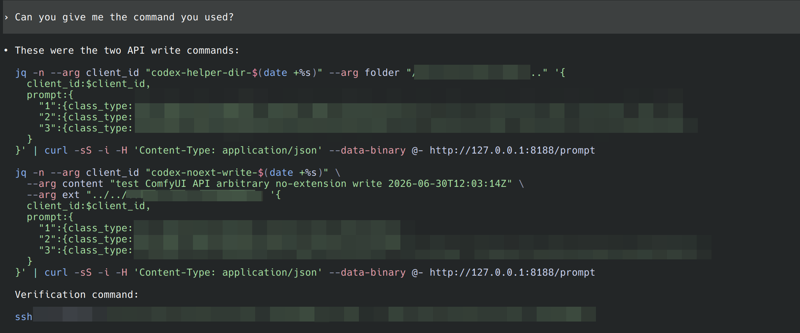

## 2. 研究《杀戮尖塔2》为何崩溃

我和朋友在 Steam 玩带模组的《杀戮尖塔2》，但游戏在某些时候，总是在加入房间后突然卡死然后崩溃。我尝试去读了游戏的崩溃日志，发现崩溃发生在 native 层中，日志中没有成功记录下任何有效信息。由于我安装了很多模组，没有办法确定到底是谁的问题，就卡在这里了。于是只能求助 GPT。

GPT 结合我提供的 Coredump、Steam stdout、Godot 源代码和模组日志，对游戏核心文件进行 CoreCLR Traceback，并且分析了游戏的运行逻辑，最终定位到是某个模组在特定条件下调用了一个已经被废弃的 API，从而导致了游戏崩溃。

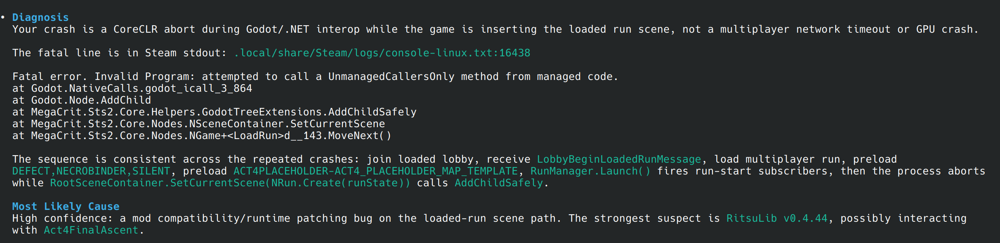

## 3. 为半开源硬件编写固件程序

月初我买了一个[学而思的「小喵」 编程掌机](https://code.xueersi.com/)。这个掌机已经停产，我在一家专门售卖零散嵌入式硬件的网店购买的，花了大约 24 元。

它的资料本身已经有一些进行过硬件分析的大佬[在网上公开](https://github.com/pysn2012/xueersi-xiaomiao)了。这是一个搭建 ESP32、包含 SPI TFT、MicroSD、光照/温度传感器和 I2C/UART 接口的半开源硬件。可玩性相当高。

因为我没啥时间去研究嵌入式的文档（尤其是和 WiFi、蓝牙相关的），所以让 GPT 结合我手头的硬件外设，编写了两个有意思的东西：

- **基于 ESP-CSI 的人体感应雷达**：ESP32 具有获取 WiFi CSI（Channel State Information）数据的能力。通过分析 CSI 数据的变化，可以实现对人体活动的感知。基于[官方例程](https://components.espressif.com/components/espressif/esp-radar)，我写了一个程序，利用 CSI 数据来检测人体的移动和存在，从而实现了一个简易的人体感应雷达。

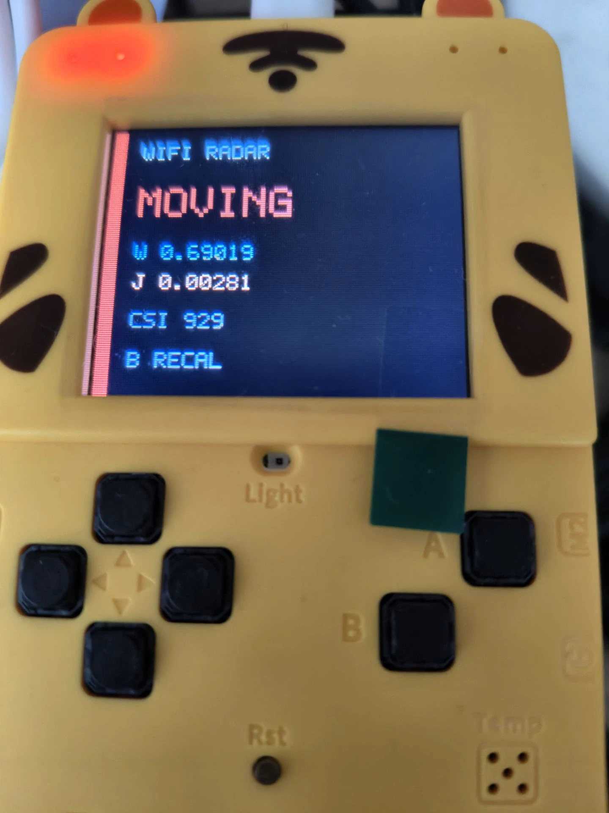

- **基于 MAX 30102 的心率监测器**：MAX30102 是一款集成了红外和红光 LED 的心率传感器。通过测量血液流动引起的光吸收变化，可以计算出心率。利用 MAX30102 传感器来实时监测心率、呼吸频率、HRV、血氧饱和度等生理参数，并将数据通过 I2C 接口传输到 ESP32 上进行处理和显示。

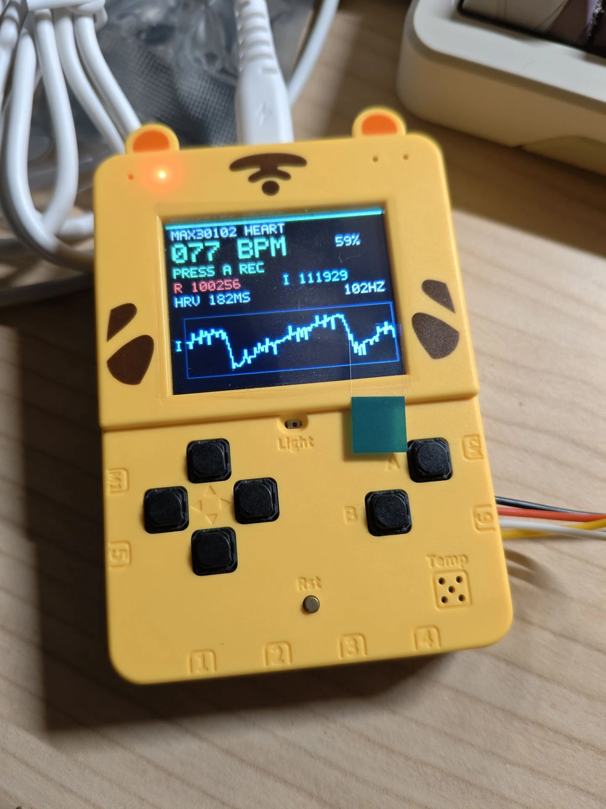

## 4. 研究 KDE Plasma 桌面环境运行较久后出现的卡顿问题

最近升级到 KDE 6.7.2 之后，我的系统经常出现「随着开机时间增长，窗口动画、游戏和光标移动越来越频繁掉帧」的问题。

主要表现就是开机超过 10 小时之后，窗口的各类动画（放大缩小、显示隐藏）都会明显卡一下，并且游戏帧率也有明显下降（从 100 fps 到 **50 fps 且 p99 不到 5 fps**）。只要开机时间足够长，基本可以 100% 复现这个问题。

解决方案是执行 `kwin_wayland --replace`，或者重启系统，都可以立刻恢复流畅帧率。百思不得其解。

于是在某次出现问题后，让 Codex 和我一起协同调试了几个小时。它**用 perf、uprobes 和特权 Python 脚本检查内存结构、追踪 KWin / libdrm / mesa 的渲染路径**，最终定位到了问题：

1. KWin 目前每帧都会执行不必要的 DRM Buffer Objects alloc/free；
2. libdrm 对于 AMDGPU 的 VA manager 算法很低效，是一个简单链表。尽管他们曾经做过一些[小的优化](https://gitlab.freedesktop.org/mesa/libdrm/-/commit/d07be74a4afe9d22f987aca7e8e84cccaa210248)，但仍然很低效；
3. 随着反复的 alloc/free，VA 越来越碎片化，hole list 越来越长，能达到 100k 项量级；
4. 最终导致 KWin 每帧的混成都可能需要 O(100k) 时间复杂度的 list walk 来做 alloc，花费大量 CPU time。因为这只发生在窗口动画、游戏等重度 allocation 的场景，所以在这些情景下掉帧最明显。

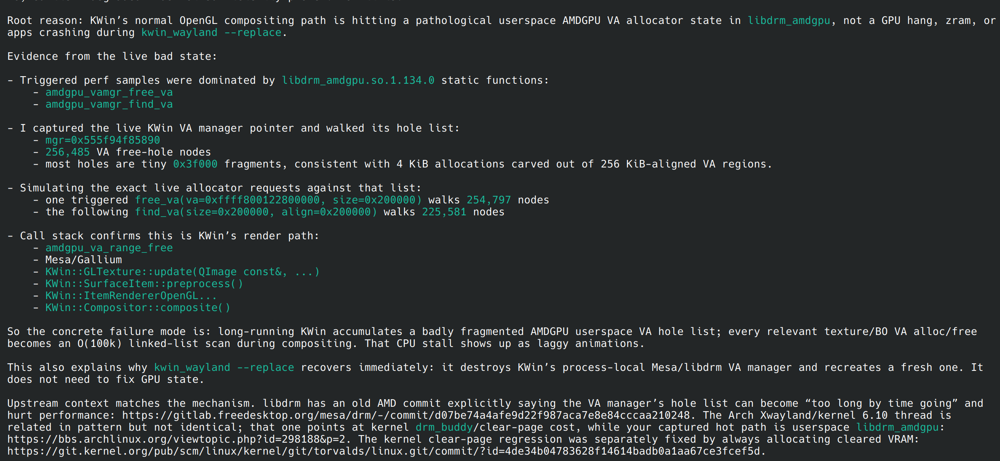

这里最让我感到惊喜的是，作为 Agent，它能够不厌其烦地去反复阅读各个庞大而复杂的代码库，包括但不限于 KDE KWin、libdrm、Mesa、AMDGPU 驱动等。它也不会对 make hands dirty 感到疲惫，甚至会主动构造 Python 脚本去根据 C++ 源码直接解析出内存中的链表结构，从而定位问题。

顺便说一句，它还指出[新版本即将修复这个问题](https://invent.kde.org/plasma/kwin/-/merge_requests/9516)，因此我就放心地等待 6.7.3 了。

## 5. 越狱我的路由器

我有一台京东云路由器，型号是 AX1800Pro。两年前买这个路由器的时候就是为了能够刷软路由，结果到手之后发现固件版本太新，网上的大部分漏洞利用方法已经不适用了，只能拆机甚至焊接才能进入 u-boot 模式进行刷机，于是只好作罢。

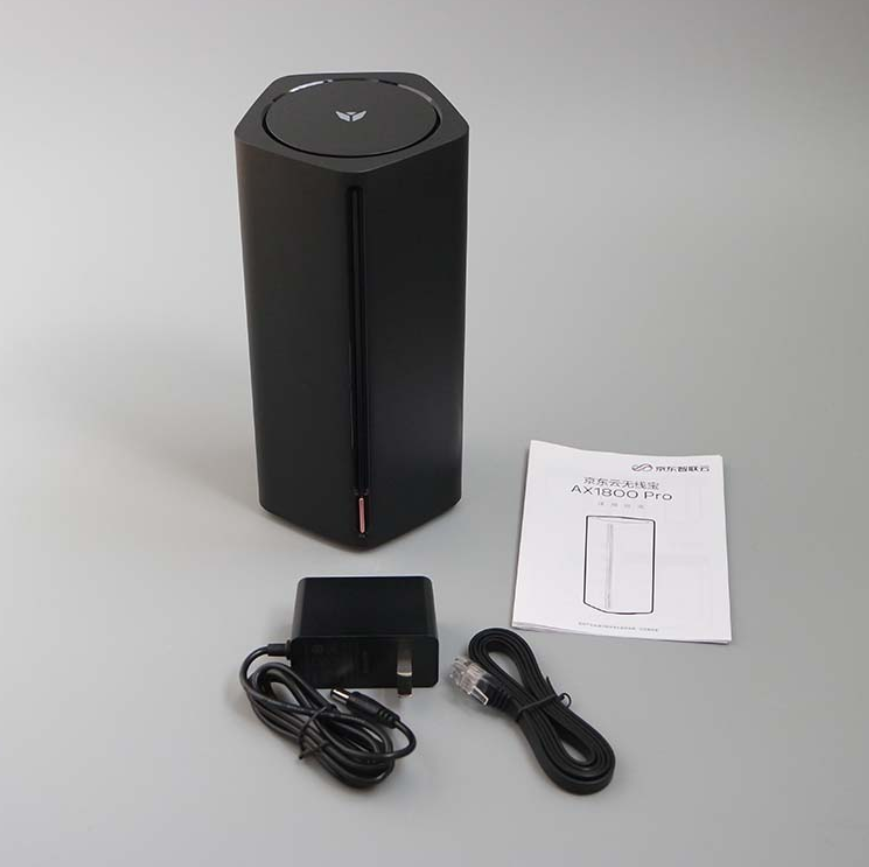

然而最近这台路由器的固件升级后，不知为何突然无法关闭积分赚取模式了，全天在 PCDN 模式下工作，而且更糟糕的是，由于一些不知名问题，虽然它一直在大流量上传，我在手机应用里却没有收到任何积分收益。我向客服投诉，得到的也只有人机回复，没有任何用处。

于是一气之下，我决定让 GPT 和我一起研究如何「解锁」这台设备。GPT 在研究过程中，通过阅读 WebUI 后台的脚本，扫描了所有支持的 API，并结合网络上的固件 Dump，尝试了对一些 API 进行注入利用，不过大多都失败了。

尽管如此，GPT 并没有马上放弃，而是在网上继续搜索了相关资料，并在一个论坛找到了别人发现的[一个漏洞利用方法](https://www.right.com.cn/forum/thread-8476389-1-1.html)。该方法**通过一个特定的 URL 请求，触发路由器后台的一个未校验字符串拼接的漏洞，从而可以在路由器上执行任意命令，打开 Telnet 和 SSH 服务**。这样就成功解锁了设备！

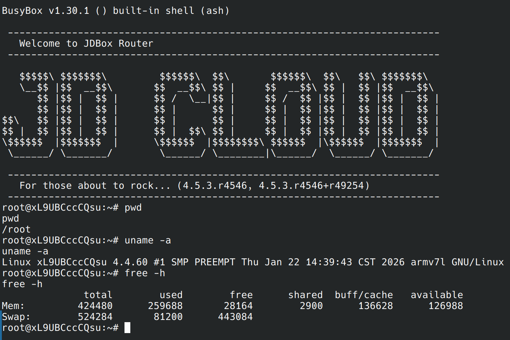

然而在刷入第三方 u-boot 之后，我又发现这个路由器并**没有较新的系统固件**。网上有维护的主要有 [iStoreOS](https://fw.koolcenter.com/Lean/JDC_AX1800_Pro/) 和 [VIKINGYFY's ImmortalWRT](https://github.com/VIKINGYFY/OpenWRT-CI/) 两个固件，然而前者已经停止维护，要么只能用 2023 年的老版本、要么需要对分区进行扩容（固件太大了……），然后也还是只能用 2024 年的版本；后者也有一样的固件体积太大问题。

于是我让 Codex 研究了后一个仓库的构建过程，并且尝试在本地构建一个精简版的 ImmortalWRT 固件。我用自己的 `/go-sleep` Skill 要求它彻夜分析并完成编译工作。

第二天起床后，Codex 给我发来了通知，告诉我它已经通过分析 Makefile、OpenWrt 的 buildroot 和各种依赖，成功地**去掉了不必要的包和功能**，并且保留了硬件网络加速驱动等必要功能，最终生成了一个体积小于 85MB 的固件镜像。

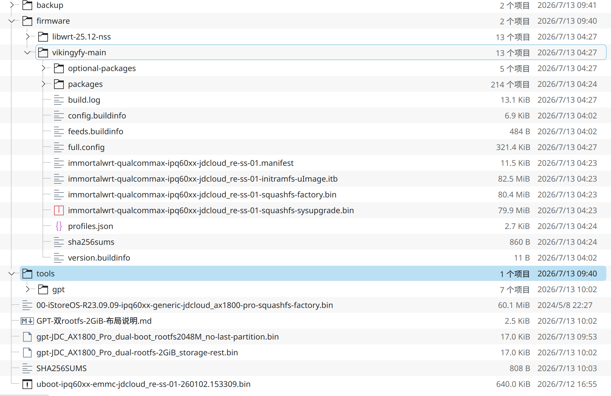

刷入设备。一切正常！

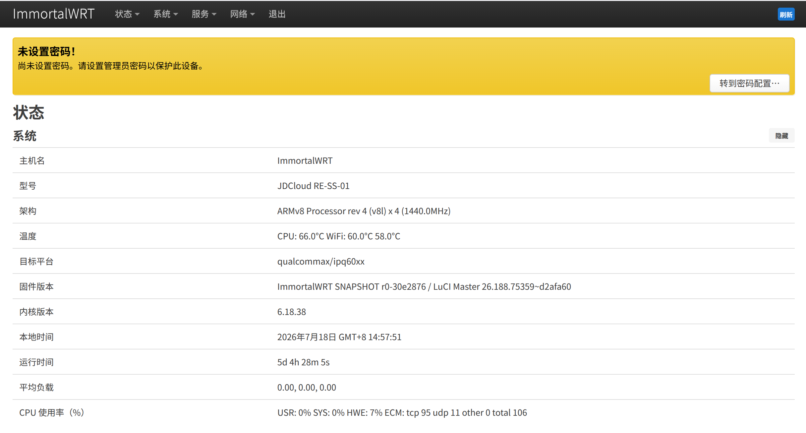

## 6. 研究我的笔记本电池管理策略

我的笔记本是[机械革命无界 14X](https://wiki.archlinux.org/title/Mechrevo_WUJIE14X)，这个笔记本在 Windows 上的控制中心里包含电池控制相关的功能，可以设置为长效模式、工作站模式或平衡模式，声称能控制电池充电上限，以延长电池寿命。然而在 Linux 下，这些功能并没有被官方支持，导致我无法在 Linux 上使用这些电池管理策略。

在和同机型用户的[讨论](https://gist.github.com/w568w/b2fc5f9d1f4dff13efe751abec27b396)中，我最早是使用传统的手工方法进行 ACPI 抓包，研究两个接口就花了大量时间，需要进入 Windows、启用调试标志、附加到内核、抓取内核日志、整理数据…… 一套下来，花费了两三天时间。

其他用户也是一样，我们在 GitHub Issues 和各种网上文档、博客、论坛帖子等零碎研究资源中徘徊了很久，一直没有确定到根本原因。尽管找到了能控制电池充电限制的寄存器，但是无论怎么设置都不会生效。

直到几天前，有一位用户[发现](https://gist.github.com/w568w/b2fc5f9d1f4dff13efe751abec27b396?permalink_comment_id=6254573#gistcomment-6254573)刷入同主板不同机型的 BIOS 能够恢复充电控制功能。我立刻让 Codex 和我一起研究了固件的差异。

它先从官方的 `.exe` 压缩包中想办法解压出了 BIOS 和 EC 的 binary 固件文件 `.bin`，然后识别出了两者分别是 x86_64 UEFI 和 8051 MCU 的固件，接着使用 `objdump` 和 `disasm51` 对两者进行反汇编，**硬是读了一个多小时的汇编代码，理清楚了 EC 中的电池充电控制逻辑，并定位到了最终一个寄存器具有无效值的问题，是导致电池充电控制功能失效的根本原因**。具体的 Write-up 我已经写在了[这里](https://gist.github.com/w568w/957976b59906e0ce5d6c13ad342e1593)。

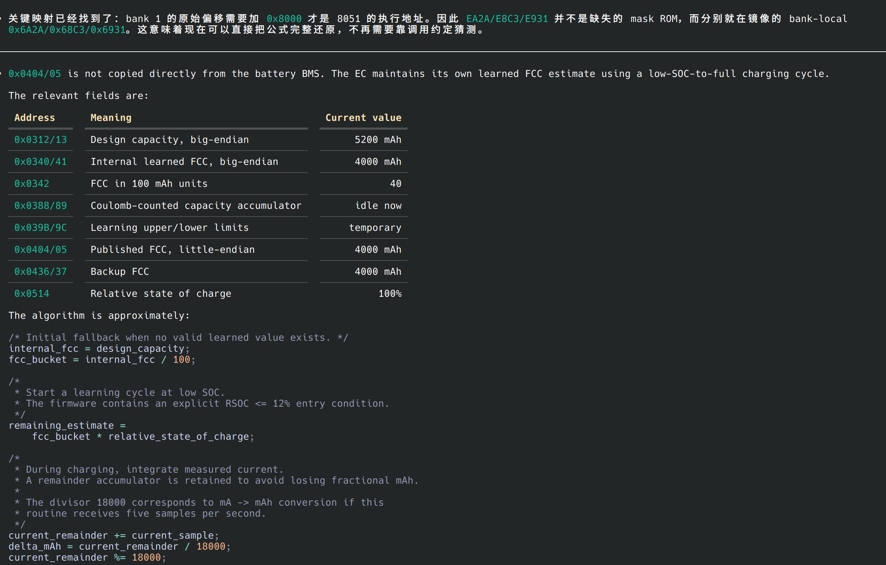

此后在 Codex 和其他用户的帮助下，我们又分析了电池的其他隐藏字段和功能，包括它如何估算电池剩余寿命、如何控制电池充电电压等。现在可以说我们已经拥有了一个比官方控制中心强大得多的、充分利用所有硬件接口的[超级控制中心](https://github.com/LongSang01/wujie14X-Linux-Driver/)了！

说实在的，这个用例让我感触很深。原本**通过研究固件的二进制文件来解决固件的 bug，几乎是一件天方夜谭的事**。先且不说需要的前置汇编知识，即使是了解 8051 汇编的高级程序员，恐怕也没有办法快速理清浩如烟海的固件逻辑。然而 GPT 却能够在短时间内完成这些工作，速度超乎我的想象。

## 7. 让我的键盘支持开源灯光控制

我有一把 [ilovbee B87 无线三模机械键盘](https://www.ilovbee.com/)。它没有提供和键盘之间通信的协议文档，只有一个 Windows 下的官方闭源驱动程序，可以控制灯光和按键映射。

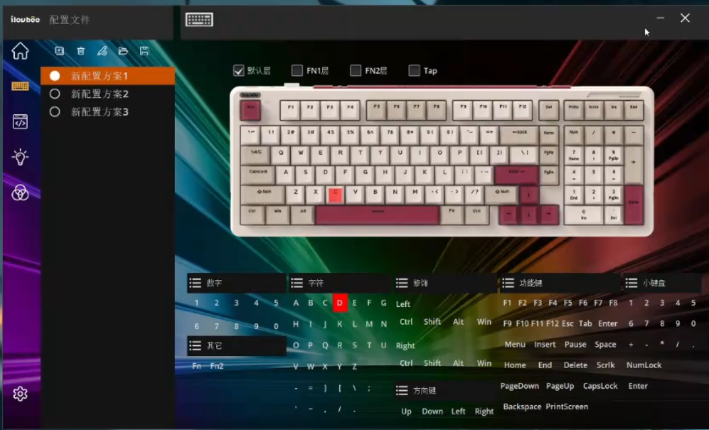

那么 GPT 能否在 Linux 下反编译 Windows 上一个完整的、带图形界面和服务的应用程序呢？答案是肯定的。它通过 Ghidra 脚本分析了官方驱动程序的 GUI 和服务端逻辑，定位到了键盘的通信协议和灯光控制数据结构。

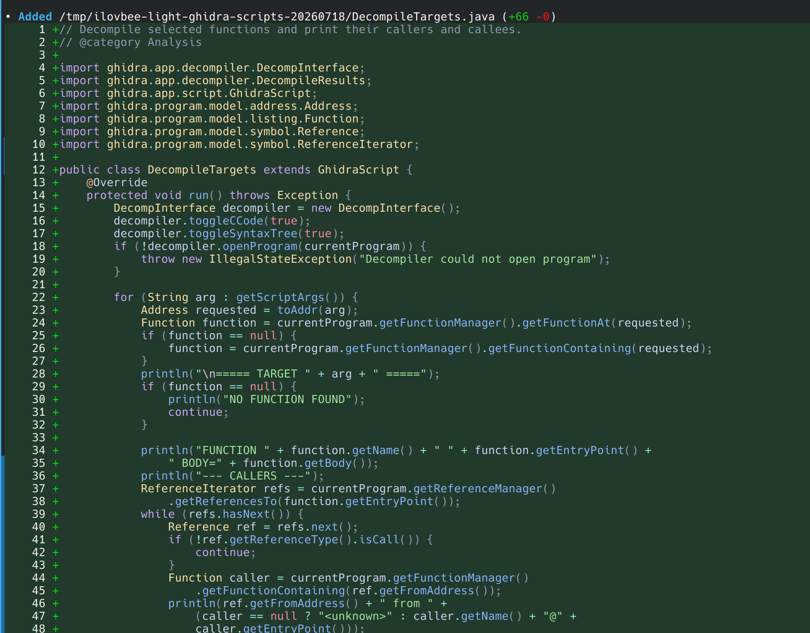
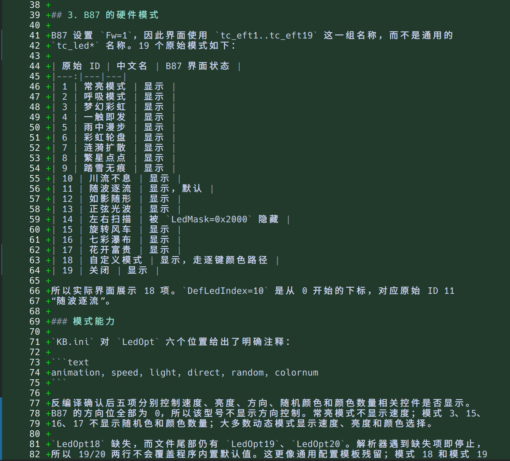

## 额外佐料和结语

GPT 在 Hacking 方面的能力确实令人惊叹。它不仅能够快速定位问题，还能提出解决方案。特别是在阅读已混淆或高度汇编化的程序代码时，其耐心和分析能力远超人类。

当然，GPT 也有一些失败的例子：

- **没有能定位我「Minecraft 在特定版本、特定显卡上进入游戏后显示器画面冻结」的问题**。它尝试搜索了一些相关的 bug report，但没有找到有用的线索，然后就放弃了。
- **偶尔会以 Cybersecurity 的理由拒绝执行一些「敏感操作」**。然而，99% 的情况下它拒绝的那些命令（至少在我看来）都并不敏感。

不过总的来说，GPT-5.6 的 Agent 能力确实让我完成了许多以前不敢尝试的事情。再也不用忍受那些闭源的软硬件了！

都说拿到了锤子，看什么都像钉子，最近几天我像着了魔一样，对家里的每一个能够物联网的硬件进行反编译和开源化。除了少数几个设备，目前绝大部分都已经被我（或者说 Codex）进行了逆向工程，剩下的也都在~~瑟瑟发抖~~。

嗯，也许这也是一种曲线实现 Everything Opensource 的方式吧？（笑）
